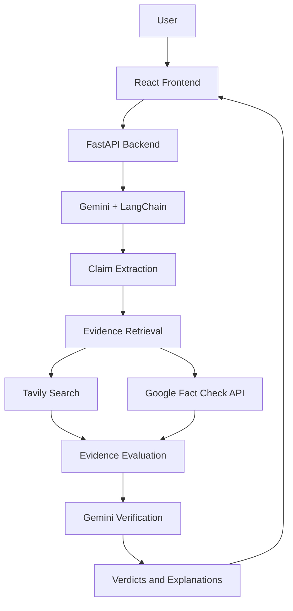

# VERITAS — Facts Before Beliefs

**An LLM-powered fake news detection and claim verification system.**

VERITAS uses Google Gemini, LangChain, Tavily, and Google Fact Check API to extract factual claims from news articles, retrieve relevant evidence, and generate evidence-based verdicts.

## ✨ Features

- 🧠 **LLM-based verification** using Google Gemini
- 🔎 **Web evidence retrieval** using Tavily
- ✅ **Fact-check lookup** using Google Fact Check API
- 📝 **Claim extraction** from news articles
- ⚖️ **Claim-level verdicts** with explanations
- 🔗 **Source references** for independent verification
- 🌐 **Interactive web interface** with React

## 🛠️ Tech Stack

| Component | Technology |
|---|---|
| LLM | Google Gemini |
| LLM Framework | LangChain |
| Web Search | Tavily |
| Fact-Check Retrieval | Google Fact Check API |
| Backend | Python, FastAPI |
| Frontend | React, Vite |

## 🏗️ Architecture



## ⚙️ How It Works

1. **Input:** User submits a news article or claim.
2. **Extraction:** Gemini identifies verifiable factual claims.
3. **Retrieval:** Tavily searches the web, while Google Fact Check API retrieves relevant existing fact-checks.
4. **Verification:** Gemini evaluates the available evidence through the LangChain-integrated pipeline.
5. **Output:** VERITAS returns claim-level verdicts, explanations, and available source links.

## 🚀 Getting Started

### 1. Clone the repository

```bash
git clone https://github.com/adrijghosh8/Veritas-fake-news-detector.git
cd Veritas-fake-news-detector
```

### 2. Run the backend

```bash
cd backend
python -m venv venv
venv\Scripts\activate
pip install -r requirements.txt
uvicorn main:app --reload
```

Configure your API keys in a `.env` file using the variable names expected by your backend.

### 3. Run the frontend

Open a second terminal:

```bash
cd frontend
npm install
npm run dev
```

Open the local URL provided by Vite. FastAPI documentation is available at `http://127.0.0.1:8000/docs`.

## ⚖️ Verdicts

- **SUPPORTED** — Available evidence supports the claim.
- **REFUTED** — Available evidence contradicts the claim.
- **UNVERIFIED** — Available evidence is insufficient to reach a conclusion.

*Verdict labels depend on the implemented verification pipeline. AI-generated results can be incorrect; always review the original sources.*

## 🔮 Future Improvements

- Source credibility and publication-date analysis
- Improved contradiction detection
- Multilingual claim verification
- Confidence calibration and automated evaluation

## 👨‍💻 Author

**Adrij Ghosh**  
B.Tech CSE | AI & LLM Applications

[GitHub Repository](https://github.com/adrijghosh8/Veritas-fake-news-detector)

---

<p align="center">
  <strong>VERITAS — Facts Before Beliefs.</strong><br/>
  Don't just read the claim. Verify the evidence.
</p>
